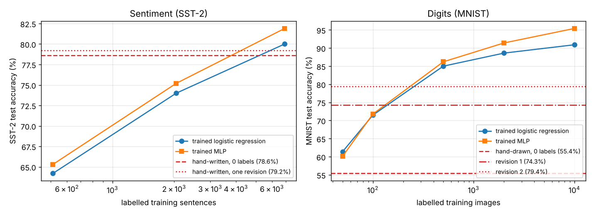

# handnet — neural networks with hand-written weights

Networks whose weights are **designed, not trained**. The architecture is an ordinary
neural network (embeddings, convolutions, recurrences, MLPs, ReLUs) and it runs in numpy
or PyTorch like any other, but every non-zero weight was placed by reasoning about the
task. The result is a model that is readable, auditable, deterministic, needs no data
and no GPU, and is still a real network you can fine-tune, distil into, or compare
against a trained one.

The project collects such networks, documents how to build them, and measures how far
the approach carries.

| Network | Task | Params | Non-zero | Headline result |
|---|---|---|---|---|
| [`handnet/text_quality.py`](handnet/text_quality.py) | text quality 0–100, any language | 100,331 | 627 | AUC 0.86–0.95 kept-vs-removed FineWeb-2 docs in 8 scripts |
| [`handnet/sentiment.py`](handnet/sentiment.py) | positive/negative, SST-2 | 9,146 | 1,567 | **78.6%** test with 0 labels seen, 79.2% after one revision; beats logistic regression trained on 2,048 sentences |
| [`handnet/mnist.py`](handnet/mnist.py) | handwritten digits | 28,234 | 662 ink pixels | 55.4% blind, **79.4%** after two revisions ≈ a classifier trained on 200 images — here training wins |



The sentiment and MNIST networks were written by Claude Fable 5.1 under a strict protocol
(blind write → sealed test set → bounded revisions, each reported with the labels it looked at →
trained baselines at matched label counts). Hand-writing wins where the features are
*nameable* (words, negation, markup, mojibake) and loses where they are statistical
regularities in pixel space. See [METHOD.md §7](METHOD.md#7-the-protocol-for-a-fair-comparison-with-training).

More networks are being added; see [COORDINATION.md](COORDINATION.md) for what is in
progress and how to add one.

## Quick start

```bash
git clone https://github.com/BirgerMoell/handnet && cd handnet
pip install numpy            # the only runtime dependency
python -m pytest -q tests

python examples/sentiment/eval_sst2.py      # SST-2: 79.2% test, 81.4% dev
python examples/mnist/eval_mnist.py         # MNIST: 79.4% test
python examples/sentiment/baselines_sst2.py # trained rows (pip install scikit-learn)
python examples/mnist/baselines_mnist.py

python - <<'EOF'
from handnet import sentiment, mnist
print(sentiment.score("not a bad film at all"))        # 0.615
print(sentiment.explain("it is never boring"))
from handnet.text_quality import HandNet
net = HandNet()
print(net.n_params, net.n_nonzero)                    # 100331 627
print(net.score("Hunden springer i parken. Den är glad och leker."))
print(net.explain("<div><ul><li>Home</li></ul></div> |||| ===="))
# {'score': 24.7, 'base': 72.0, '-markup': 20.0, '-few_letters': 11.3, ...}
EOF
```

## Why hand-written weights?

A trained 100k-parameter model uses all 100k weights a little. A designed one uses a
few hundred weights a lot, and zeros the rest. That difference is the point:

- **Every unit has a name.** `-mojibake`, `+sentences`, `gate:len100`. `explain()` is not
  a post-hoc attribution method; it is the network.
- **No data, no leakage, no drift.** The text-quality net has never seen a document. Its
  behaviour on Georgian is the same reasoning as on Swedish, because the input is
  Unicode attributes rather than a vocabulary.
- **The weights are the spec.** Changing a threshold is a one-line edit with a known effect,
  and tests pin the behaviour.
- **It is still a network.** Same tensors load into `nn.Module`; you can initialise a
  trained model from it, add it as a frozen branch, or measure how much training adds on
  top of design.

The method, with the full toolbox of hand-built units (range detectors from ReLU pairs,
`min(a, b)` gates, run-length counters as a ReLU-RNN, first-of-run counting with
`x − same_prev`), is in [METHOD.md](METHOD.md).

## Repository layout

```
handnet/            the networks, one module each, numpy only
examples/<name>/    demo, evaluation scripts, results and worked explanations per network
tests/              behavioural tests that pin what each network must and must not do
docs/               the GitHub Pages site (https://birgermoell.github.io/handnet)
paper/              the write-up: method, experiments, results
METHOD.md           how to hand-write a network, step by step
COORDINATION.md     task board and conventions for people/threads working in parallel
```

## Citing

Paper in preparation; see [paper/](paper/). Until then:

```
@misc{handnet2026,
  title  = {handnet: neural networks with hand-written weights},
  author = {Mo\"ell, Birger},
  year   = {2026},
  url    = {https://github.com/BirgerMoell/handnet}
}
```
