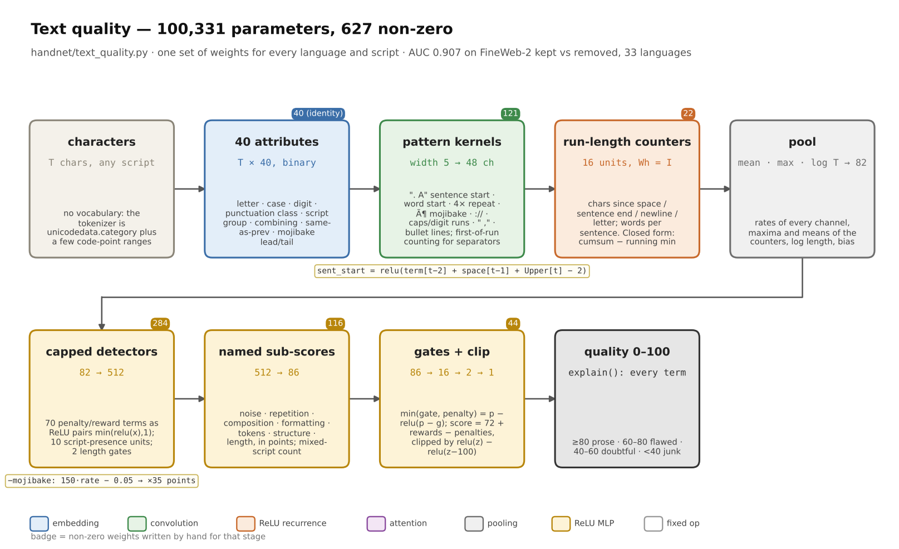
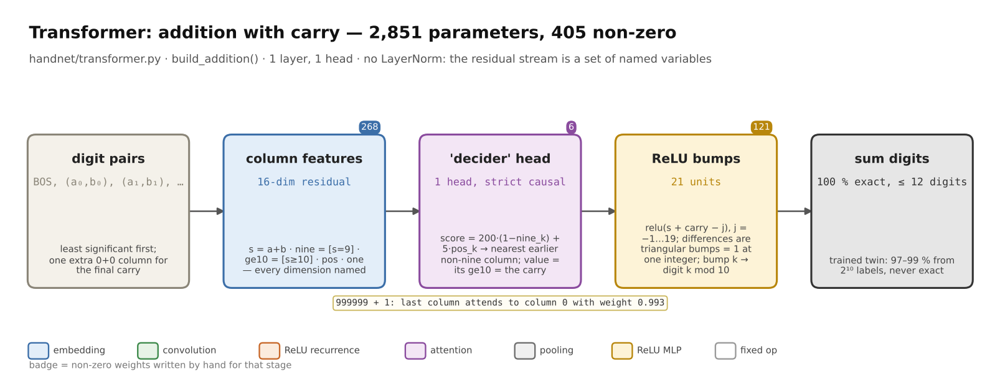
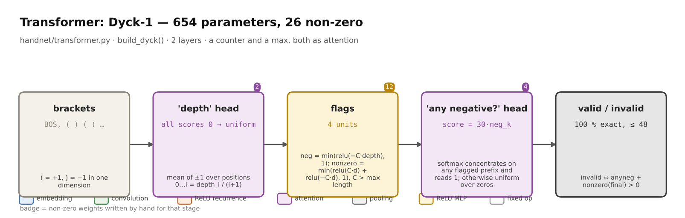
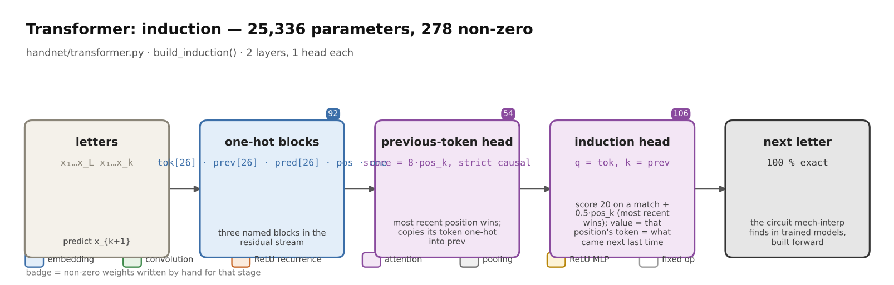
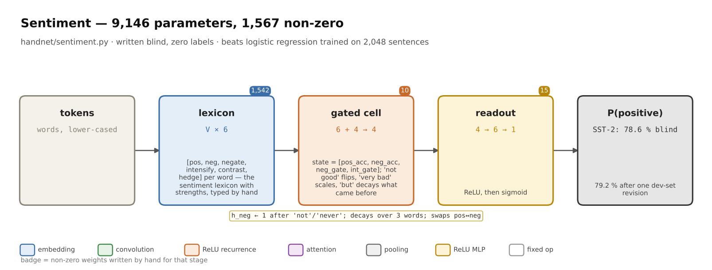
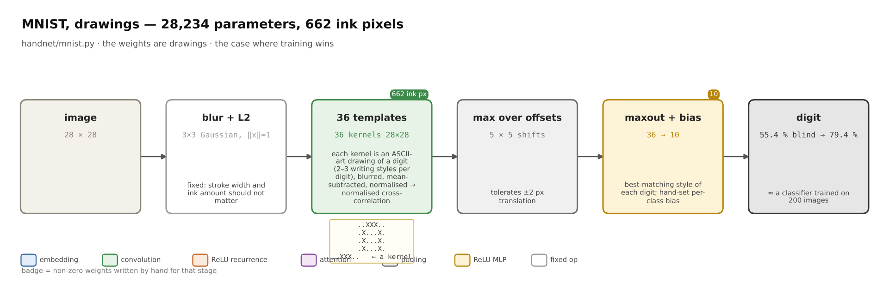
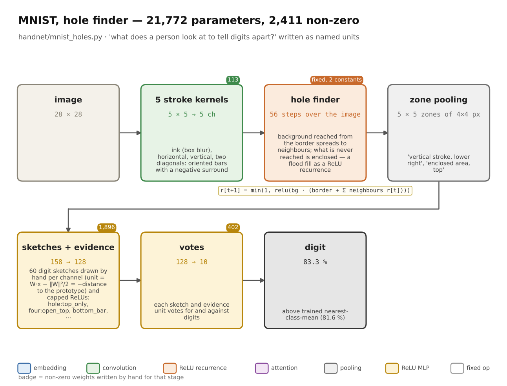

# Architectures

Every network in handnet, drawn in one style. A box is a stage; its colour is the kind of
operation; the line under the name is the tensor shape; the grey note is the hand-set
construction; the badge is the number of non-zero weights written for that stage.
Source: `examples/figures/architectures.py`.

## Text quality

[page](text_quality.html)

## Transformers

[page](transformer.html)

## Sentiment

[page](sentiment.html)

## MNIST, drawings

[page](mnist.html)

## MNIST, hole finder

[page](mnist_holes.html)
