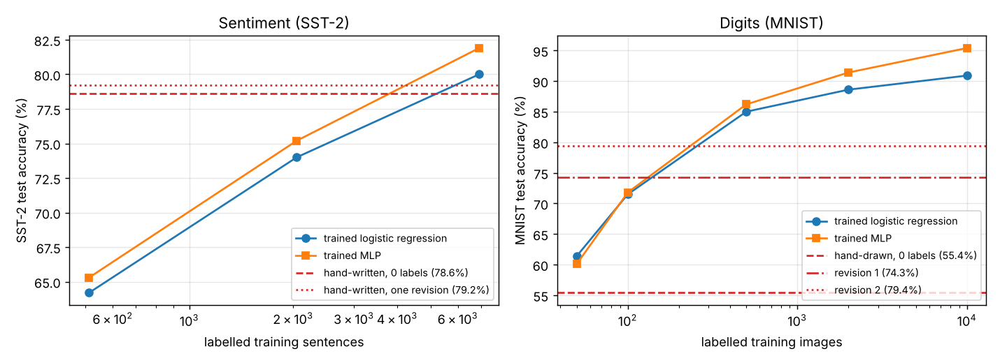

# handnet

**Neural networks whose weights are written by hand, not trained.**

Ordinary architectures — embeddings, convolutions, ReLU recurrences, MLPs — with every
non-zero weight placed by reasoning about the task. Readable, auditable, deterministic,
data-free, and still a real network you can export to PyTorch and fine-tune.

[Source on GitHub](https://github.com/BirgerMoell/handnet) · [Architectures](architectures.html) · [Method](method.html) · [All results & live demo](results.html) · [Paper (PDF)](handnet.pdf)

## Networks

| Network | Task | Params | Non-zero | Result |
|---|---|---|---|---|
| [Text quality](text_quality.html) | 0–100 quality score, any language or script | 100,331 | 627 | mean AUC **0.907** on FineWeb-2 kept vs removed, 33 languages (0.82–0.98) |
| [Sentiment](sentiment.html) | positive / negative, SST-2 | 9,146 | 1,567 | 78.6% test with 0 labels seen (79.2% after one revision); beats a logistic regression trained on 2,048 sentences |
| [MNIST](mnist.html) | handwritten digits | 28,234 | 662 (ink pixels) | 55.4% blind, 79.4% after two revisions — worth ≈ 200 labelled images; here training wins |
| [MNIST, hole-finder design](mnist_holes.html) | handwritten digits, second design | 21,772 | 2,411 | **83.3%** test; tuned by hand on 5,000 training images (not blind); above a trained nearest-class-mean (81.6%) |
| [Transformers](transformer.html) | addition with carry, Dyck-1, induction — attention written by hand | 2,851 / 654 / 25,336 | 405 / 26 / 278 | **100%** exact, 0 labels; trained twins need ~1k examples |

The text and digit networks run live in your browser on the [results page](results.html#demo): paste a text, or draw a digit.

## Designed vs trained, per label



Dashed red lines are the hand-written networks; curves are the same architectures *trained* on
increasing numbers of labels. On sentiment the blind network is worth about 3,000 labelled
sentences. On MNIST the best hand-drawn network is worth about 200 and the trained curve keeps
climbing. The difference is whether the discriminative features are *nameable*: sentiment words,
negation and markup are; the pixels that separate a 3 from a 5 are not. The protocol for making
this comparison — blind write, sealed test set, bounded revisions each reported with the labels it
looked at, trained baselines at matched label counts — is in [Method, section 7](method.html#7-the-protocol-for-a-fair-comparison-with-training).

## The idea in one example

```python
from handnet.text_quality import HandNet
net = HandNet()
net.explain("Vi är glada att kunna meddela att företaget nu öppnar ett nytt kontor.")
# {'score': 47.7, 'base': 72.0, '-mojibake': 35.0, '+sentences': 8.0, '+clauses': 4.0, ...}
```

The `-mojibake` term is a conv kernel that fires on `Ã` followed by `¶ ¤ ¥ © ¼ …`, pooled
to a rate, passed through two ReLUs that turn "one per 3000 characters" into 0 points and
"one per 140 characters" into 35 points. Nothing was learned; the explanation *is* the
network.

## Why

- A trained 100k-parameter model uses every weight a little. A designed one uses a few
  hundred a lot. That makes the model a specification.
- No training data means no leakage, no bias inherited from a corpus, and identical
  behaviour on Swedish and Georgian.
- A designed network is a strong, honest baseline: it tells you what part of a trained
  model's accuracy came from knowledge you could have written down.

[How to build one →](method.html)
