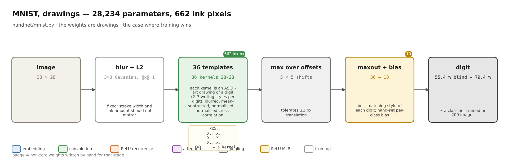
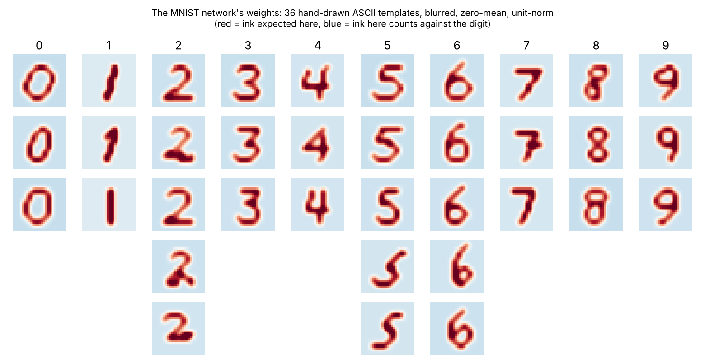
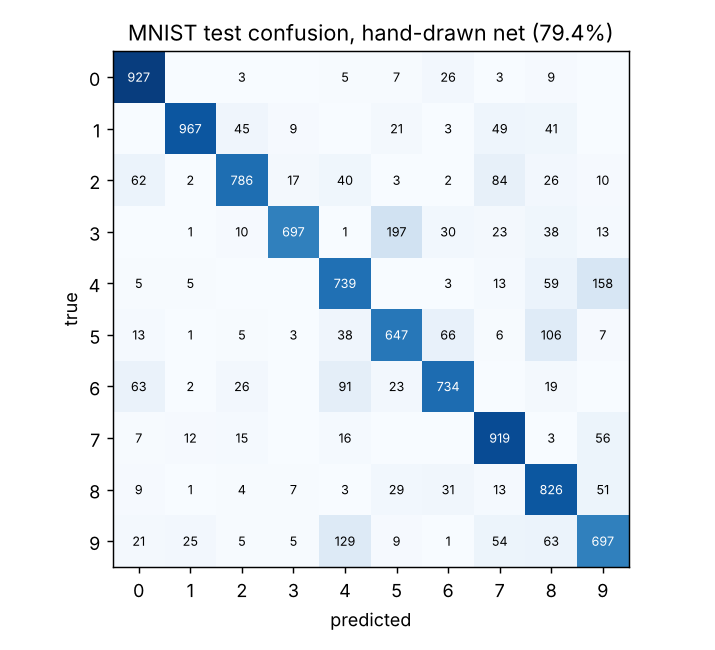
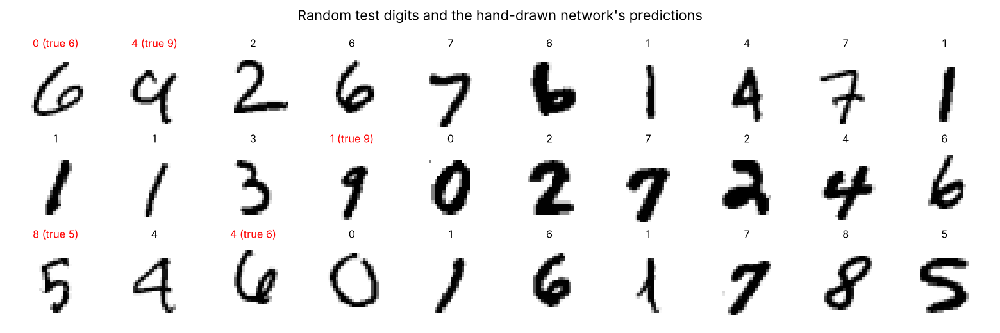

# Digits on MNIST — the weights are 36 ASCII drawings




[Source](https://github.com/BirgerMoell/handnet/blob/main/handnet/mnist.py). 662 hand-drawn ink pixels, no training, numpy only. **55.4% blind, 79.4% after two revisions** — what a trained classifier gets from about 200 labelled images. This is the case where hand-writing loses, and the confusion matrix explains why.



All 36 weights after the fixed expansion to 28×28 kernels. Red: ink expected. Blue: ink here is evidence *against* this digit. Each column is one class; rows are writing styles that a maxout layer chooses between.

## Results

| Weights | Labels seen | Ink pixels drawn | Templates | Test accuracy |
|---|---:|---:|---:|---:|
| **Hand-drawn** | 0 | 544 | 28 | **55.4%** |
| **Hand-drawn, revision 1** | 500 (class means viewed) | 553 | 30 | **74.3%** |
| **Hand-drawn, revision 2** | 500 (error images viewed) | 662 | 36 | **79.4%** |
| Trained logistic regression | 50 | — | — | 61.4% |
| Trained logistic regression | 100 | — | — | 71.5% |
| Trained MLP (64 hidden) | 100 | — | — | 71.8% |
| Trained logistic regression | 500 | — | — | 85.0% |
| Trained MLP (64 hidden) | 500 | — | — | 86.2% |
| Trained logistic regression | 10,000 | — | — | 90.9% |
| Trained MLP (64 hidden) | 10,000 | — | — | 95.4% |

MNIST test set, 10,000 images. Chance is 10%.

## Architecture

```
image 28×28
  → 5×5 Gaussian blur (fixed) → zero-mean, unit-norm       ink amount should not matter
  → Conv2d(1 → 36, kernel 28×28, padding 3)                 36 hand-drawn templates
  → MaxPool over the 7×7 offsets                            tolerates ±3 px translation
  → Maxout 36 → 10 (best-matching style of each digit)
  → + per-class bias → argmax
```

A template is typed as 14×14 ASCII art. A fixed, parameter-free function turns it into a kernel: upsample ×2, widen the stroke to ~3 px with a cross-shaped 3×3 kernel, blur, subtract the mean, divide by the norm. Because the kernel is zero-mean and unit-norm the convolution output is a cosine similarity, and ink *outside* the stroke pulls the score down. That one detail was the difference between a 0 template that also fires on every 8 and one that does not.

```
0 (style 1)        1 (slanted, flag)   2 (loop base)       7 (with bar)
..............     ..............      ..............      ..............
..............     ..............      ..............      ..............
..............     ..............      ..............      ..............
......###.....     ........#.....      ......###.....      ..............
.....#...#....     .......##.....      .....#...#....      ....######....
....#.....#...     ......#.#.....      .........#....      .........#....
....#.....#...     ........#.....      ........#.....      ........#.....
...#......#...     .......#......      .......#......      .......####...
...#.....#....     .......#......      ......##......      ........#.....
...#.....#....     .......#......      .....#.##.....      .......#......
....#...#.....     ......#.......      ....#.#..##...      .......#......
.....###......     ......#.......      ....###...#...      ......#.......
..............     ..............      ..............      ..............
..............     ..............      ..............      ..............
```

## The revisions

**Revision 1 (+19 points).** The blind drawings were systematically wrong: one grid row too high, upright instead of right-leaning, too wide. The model viewed the class-mean image of 500 labelled training digits next to its own templates and redrew all ten digits. This was the single most informative look at data in the whole project.

```
digit 7: class mean (500 train labels)   |  first blind template
   ..............                        |   ..............
   ..............                        |   ..............
   ..............                        |   ....+######...
   ..............                        |   .....+++++#+..
   ....+######...                        |   .........++...
   ...+#######...                        |   .........#+...
   ....##..+##...                        |   ........++....
   ........##+...                        |   ........#+....
   .......###....                        |   .......++.....
   .......##.....                        |   .......#+.....
   ......##+.....                        |   ......++......
   .....+#+......                        |   ......#+......
   ....+#++......                        |   ..............
   .....+........                        |   ..............
```

**Revision 2 (+5 points).** After revision 1 the weakest classes were 2, 5 and 6. The model viewed six misclassified training examples of each, drew two extra styles for each (a 2 with a looped base, a small high 2, a 5 without a top bar, a 6 with a long stem and a small low loop), widened the blur from 3×3 to 5×5 and the shift tolerance from ±2 to ±3 px.

## Why this one loses



The big off-diagonal cells are 3→5 (197), 4→9 (158), 9→4 (129) and 5→8 (106). Those pairs differ in the *presence of one small stroke* — the top bar of a 5, whether a 9's loop closes — which a whole-digit correlation barely notices against the shared bulk of the shape.

A trained linear classifier learns to put large weight on exactly those few discriminative pixels. A person drawing a prototype cannot know which pixels those are without looking at thousands of examples. The features that matter on MNIST are not *nameable*, so the "give every unit a job" step of the method has nothing to work with.

We also tried a part-based variant (hand-drawn stroke detectors into a hand-written 10×64 linear layer) and abandoned it: writing "how much does a horizontal stroke in the top-right speak for a 7" by hand for 640 cells is, on inspection, guessing.



## Reproduce

```bash
python examples/mnist/eval_mnist.py                      # revision 2, 79.4%
python examples/mnist/handwritten_mnist_v2_rev1.py       # revision 1, 74.3%
python examples/mnist/handwritten_mnist_v1_blind.py      # blind, 55.4%
python examples/mnist/baselines_mnist.py                 # trained rows (scikit-learn)
python -m pytest -q tests/test_mnist.py
```

```python
from handnet import mnist
X = mnist.load_idx("examples/mnist/data/t10k-images-idx3-ubyte.gz")
mnist.predict(X[:10]); mnist.explain(X[0])   # class scores = best template cosine per digit
```
