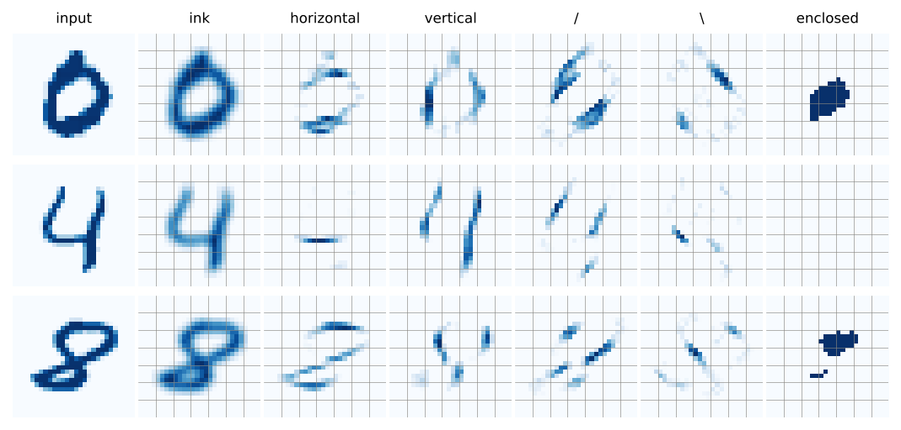
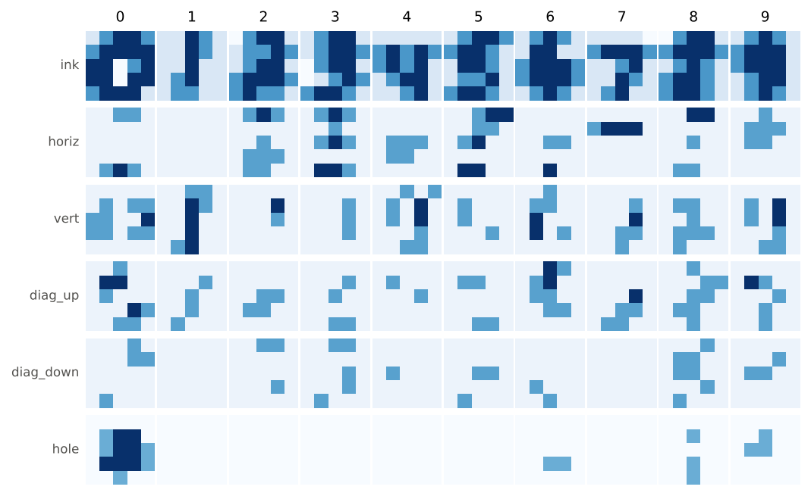
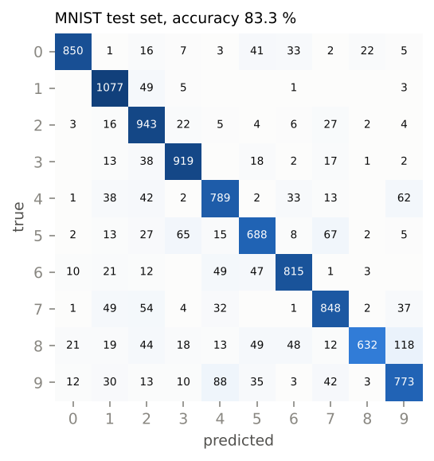

# MNIST without the training — a hand-written digit classifier

[Source](https://github.com/BirgerMoell/handnet/blob/main/handnet/mnist_holes.py) · [Results & live demo](results.html#mnist) · 21,772 parameters, 2,411 non-zero, no training, numpy only.

**83.3 % on the 10,000 MNIST test images.** Majority class: 11.4 %. A *trained* nearest-class-mean
classifier on raw pixels (fit on 20,000 training images): 81.6 %. A trained convnet: 99 %+.

```python
from handnet.mnist_holes import MNISTNet
net = MNISTNet()
net.predict(img)        # img: (28, 28) float in [0, 1] -> 0..9
net.explain(img)        # {'prediction': 4, 'logits': [(4, 31.2), ...], 'evidence_for_4': [('four:open_top', 3.5), ...]}
net.to_torch()          # the same network as an nn.Module
```

## What a person looks at, written as units



1. **Five 5×5 kernels, drawn by hand.** A box-blur *ink* channel and oriented-bar detectors for horizontal,
   vertical, `/` and `\` strokes (+1 on the bar, +1.5 at the centre, −0.25 beside it).
2. **A recurrent hole finder.** Seed the border with background; at every step a background pixel that touches
   a reached pixel becomes reached: `r ← relu(min(1, Σ₃ₓ₃ r) + bg − 1)`. After 56 steps, background that was
   never reached is *enclosed* — the loop of a 0, 6, 8, 9. The same ReLU-recurrence construction as the text
   net's run-length counters, over an image instead of a string.
3. **Zone pooling** of all six maps over a 5×5 grid of 4×4-pixel zones (the central 20×20 box).
4. **Sketches.** Every digit is drawn by hand on the 5×5 grid, once per channel, as ASCII art — these *are* the weights:

```
ink:   0 .+##+   1 ..#+.   2 -+##.   3 .+##.   4 .....   5 .+##+   6 .+#+.   7 ....-   8 -+##.   9 .+#+.
         +####     ..#+.     .++#+     .+##+     +#+#+     +##+.     .##..     +###+     +###+     +###.
         ##-+#     ..#..     .+##.     -+##.     +#+#.     .##+.     +###+     ..+#.     .+#+.     +###.
         ##-##     .+#..     +###+     -.+#+     .+##.     .++#.     +###+     ..#+.     +##+.     .+##.
         +###.     .++..     +#++.     +##+.     ..+#.     +##+.     .+#+.     .+#..     +##+.     .+#+.
hole:  0 .....   6 .....   8 .....   9 .....      (the others: none)
         .+##.     .....     ..+..     ..+..
         .+##+     .....     .....     .++..
         .###+     ..++.     ..+..     .....
         ..+..     .....     ..+..     .....
```

   A sketch is a prototype: its unit computes `W·x − ½‖W‖²`, minus the squared distance to the prototype up to a
   constant, so the readout is "which hand-drawn digit is this closest to", channel by channel (ink ×1, strokes ×2, hole ×4).



5. **Named evidence units** for topology and the confusions the sketches leave: `hole:none / big / top_only /
   bottom_only / top_and_bottom`, `narrow`, `four:open_top`, `seven:roof`, `two:foot`, `three:bumps`,
   `five:corner`, `six:left_sweep`, `nine:stem`, `zero:ring`, `eight:waist`, `bottom_bar`, `roof_row1`,
   `top_centre_filled`, … — 29 units, each `min(relu(w·f + b), 1)`, each voting for and against digits.

## How the numbers were set

The kernels, hole finder, sketches and unit definitions were written from how digits look. Thresholds were
placed by reading class-conditional means of the zone features on the first 5,000 *training* images and putting
the knee between a digit and its neighbours. Vote weights were adjusted by hand over about a dozen rounds of
"look at the confusion matrix on those 5,000 images, which unit is to blame, adjust its votes". No gradient,
optimiser or search over weights. A held-out training slice gives 82.8 %, so the hand tuning did not overfit;
the test set was scored once, at the end (`examples/mnist/eval_mnist_holes.py`).

## Test set, scored once

| true \ pred | 0 | 1 | 2 | 3 | 4 | 5 | 6 | 7 | 8 | 9 | acc |
|---|---|---|---|---|---|---|---|---|---|---|---|
| **0** | **850** | 1 | 16 | 7 | 3 | 41 | 33 | 2 | 22 | 5 | 0.87 |
| **1** | 0 | **1077** | 49 | 5 | 0 | 0 | 1 | 0 | 0 | 3 | 0.95 |
| **2** | 3 | 16 | **943** | 22 | 5 | 4 | 6 | 27 | 2 | 4 | 0.91 |
| **3** | 0 | 13 | 38 | **919** | 0 | 18 | 2 | 17 | 1 | 2 | 0.91 |
| **4** | 1 | 38 | 42 | 2 | **789** | 2 | 33 | 13 | 0 | 62 | 0.80 |
| **5** | 2 | 13 | 27 | 65 | 15 | **688** | 8 | 67 | 2 | 5 | 0.77 |
| **6** | 10 | 21 | 12 | 0 | 49 | 47 | **815** | 1 | 3 | 0 | 0.85 |
| **7** | 1 | 49 | 54 | 4 | 32 | 0 | 1 | **848** | 2 | 37 | 0.82 |
| **8** | 21 | 19 | 44 | 18 | 13 | 49 | 48 | 12 | **632** | 118 | 0.65 |
| **9** | 12 | 30 | 13 | 10 | 88 | 35 | 3 | 42 | 3 | **773** | 0.77 |



The errors are the ones a 5×5 sketch should make, and the hole finder explains most of them: 8→9 when the
lower loop did not close, 9→4 when the upper loop did not close, 4→9 with a closed-top 4, and the 5/3/7
family where a 5 with a short roof is a 3 with a corner. `hole:none` fires on 99 % of 1s, 3s, 5s and 7s —
and on 26 % of 9s and 37 % of 6s, which is where the accuracy goes.

## Reproduce

```bash
pip install -e '.[dev,eval]'
python -m pytest -q tests/test_mnist_holes.py
python examples/mnist/eval_mnist_holes.py --out examples/mnist/mnist_holes_results.json   # downloads MNIST (~20 MB)
```

[Try it in the browser →](results.html#demo)
