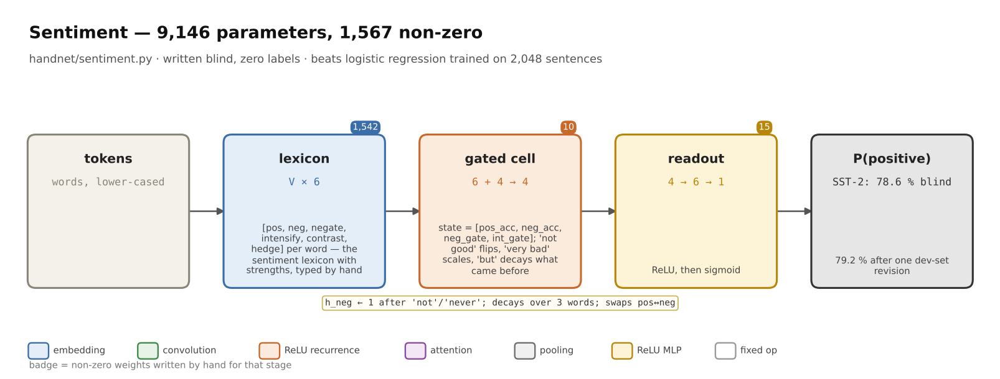
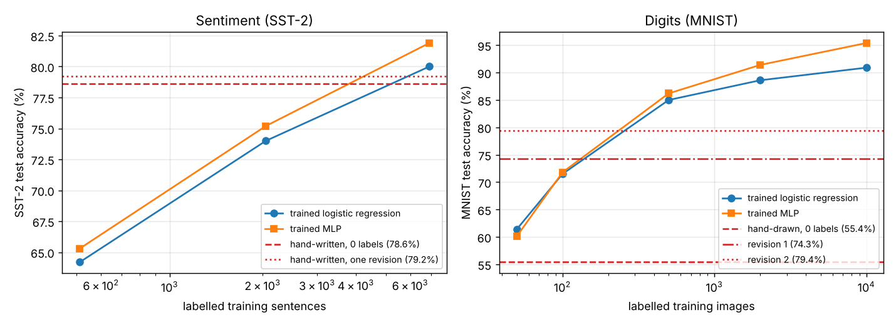

# Sentiment on SST-2 — a 1.5k-parameter hand-written net




[Source](https://github.com/BirgerMoell/handnet/blob/main/handnet/sentiment.py). 1,567 non-zero parameters, no training, numpy only. **78.6% on the SST-2 test set with zero labels seen**, 79.2% after one revision — more than a logistic regression trained on 2,048 labelled sentences.

## Results

| Weights | Labels seen | Non-zero params | Test accuracy |
|---|---:|---:|---:|
| **Hand-written** | 0 | 1,463 | **78.6%** |
| **Hand-written, one revision** | 872 (dev) | 1,567 | **79.2%** |
| Trained logistic regression, uni+bigram | 512 | 9,525 | 64.2% |
| Trained MLP (32 hidden) | 512 | 304,832 | 65.3% |
| Trained logistic regression | 2,048 | 30,884 | 74.0% |
| Trained MLP | 2,048 | 988,320 | 75.2% |
| Trained logistic regression | 6,919 | 81,032 | 80.0% |
| Trained MLP | 6,919 | 2,593,056 | 81.9% |

SST-2 test, 1,821 sentences, standard GLUE split. Chance is 50%; pretrained transformers reach 95%+. The claim is about the low-label regime: the blind network is worth about 3,000 labelled sentences.



## The task

SST-2 is the binary Stanford Sentiment Treebank: single sentences from movie reviews, lower-cased and pre-tokenised (`does n't`, `ca n't`), labelled positive or negative. It is hard for lexicon methods because review English is full of negation ("not a bad film at all"), contrast ("boring at first but ultimately moving") and intensified negatives used as praise ("painfully funny").

## Architecture

```
tokens → Embedding(V × 6)         E[word] = [pos, neg, negator, intensifier, contrast, hedge]
       → Gated recurrent cell     state h = [pos_acc, neg_acc, neg_gate, int_gate]   (10 scalars)
       → Linear(4→6) → ReLU → Linear(6→1) → sigmoid                                  (16 weights)
```

**The embedding is a lexicon.** Every word gets six numbers. About 1,100 words were typed as Python dictionaries grouped by strength 1–3, because three levels is what an annotator can do consistently.

| Axis | Meaning | Examples (value) |
|---|---|---|
| pos | positive strength | good (2), masterpiece (3), decent (0.6) |
| neg | negative strength | bad (3), dull (3), predictable (3), tries (1) |
| negator | opens a negation gate | not (1.0), n't (1.0), never (1.0), hardly (0.8), anything (0.6) |
| intensifier | scales the next word | very (0.5), extremely (0.8), painfully (0.5) |
| contrast | discounts everything before it | but (1.0), however (1.0), ultimately (0.6) |
| hedge | halves the next word; cancels an open negation | somewhat (0.5), just (0.6), merely (0.6) |

**The recurrent cell** is ten hand-set scalars, each a statement about English:

```python
W_gate_rec       = [0.72, 0.45]  # negation gate decays 0.72/token (reaches ~3 words); intensifier 0.45
W_contrast_decay = 0.35          # after "but", keep 35% of what came before
W_flip_pos2neg   = 0.65          # "not good"  → negative at 65% strength
W_flip_neg2pos   = 0.75          # "not bad"   → positive at 75% strength
W_int            = 1.0           # "very X" doubles X
W_hedge          = 1.0           # "somewhat X" halves X
W_cancel         = 1.5           # "not JUST hilarious" re-asserts hilarious
W_acc_rec        = 0.97          # mild forgetting: late clauses matter slightly more
```

Per token the cell (1) scales the accumulators down if the token is a contrast word, (2) updates the two gates with a ReLU-built `clip01`, (3) routes the word's polarity through the negation gate that was open *before* this token, and (4) adds `amp · polarity` to the accumulators, `amp = (1 + int_gate)(1 − 0.5·hedge)`. These are multiplicative gates of the kind an LSTM uses.

**The readout**: six ReLU units — net sentiment, net negativity, any positivity, any negativity, emotional mass, dangling negation — with output weights `[1.2, −1.2, 0.15, −0.35, −0.05, −0.4]` and bias −0.15. The bias encodes a prior written down before any evaluation: review sentences with nothing evaluative in them lean negative in SST-2.

## Worked examples

| Sentence | blind | revised |
|---|---:|---:|
| a very good movie | 0.97 | 0.97 |
| this is not good | 0.08 | 0.07 |
| not a bad film at all | 0.22 | 0.61 |
| it is never boring | 0.46 | 0.92 |
| boring at first but ultimately moving | 0.83 | 0.83 |
| the movie is n't just hilarious it 's witty and inventive | 0.12 | 1.00 |
| a painfully funny ode to bad behavior | 0.01 | 0.08 |
| a complete waste of time | 0.01 | 0.01 |

```python
from handnet import sentiment
sentiment.score("not a bad film at all")     # 0.615
sentiment.explain("not a bad film at all")   # per-token trace of gates and accumulators
```

## The revision

The model read 45 development-set errors (never the test set) and made five kinds of change, each a claim about language rather than a fitted number:

1. *never*, *nothing*, *hardly* were both negators and negative words, so "never boring" was negative twice over. Removed from the negative list.
2. The negation gate decayed too fast (0.55 → 0.72). "never reduces the situation to simple melodrama" now flips.
3. neg→pos flip raised from 0.45 to 0.75 after "not a bad film at all" scored 0.22.
4. Added the hedge-cancels-negation term for "not just X" / "not merely X".
5. Added ~100 lexicon entries: comparatives (*funnier*, *smartest*), horror-positive words (*creepiest*, *scariest*), review negatives (*familiar*, *tries*, *wore*), and intensifier readings of *painfully*, *brutally*, *wickedly*.

Dev accuracy went 79.6% → 81.4%; test 78.6% → 79.2%. The gap between those two gains is the honest measure of how much the revision overfit the dev set.

## What's left

The remaining errors are mostly not lexical: sentences with no evaluative word; topic words that look like sentiment ("a compelling anatomy of *grief*" is labelled negative); irony ("the only excitement comes when the credits finally roll"); and polarity carried by syntax ("what the director can't do is make either persona interesting"). A lexicon-and-gates network cannot represent the last two at all. That is the ceiling, and it is why trained transformers reach 95%+ while this stops near 80%.

## Reproduce

```bash
python examples/sentiment/eval_sst2.py                                            # 79.2% test, 81.4% dev
python examples/sentiment/handwritten_sentiment_v1_blind.py examples/sentiment/data/test.tsv   # 78.6%
python examples/sentiment/baselines_sst2.py                                       # trained rows (scikit-learn)
python -m pytest -q tests/test_sentiment.py
```
