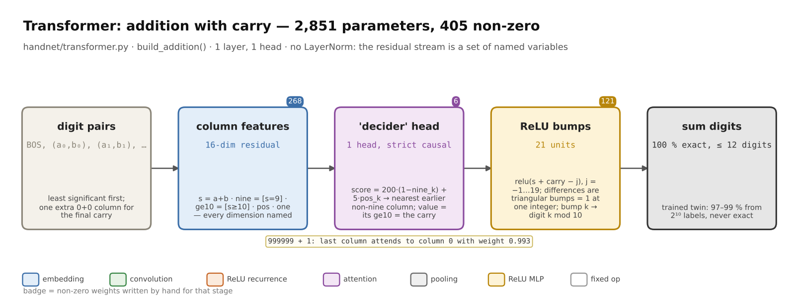
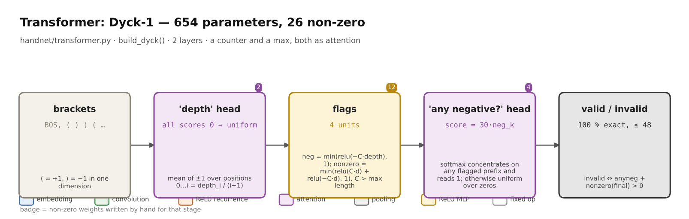
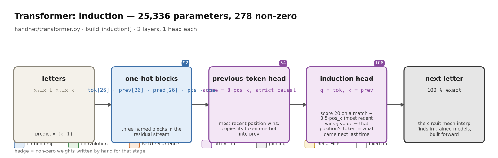
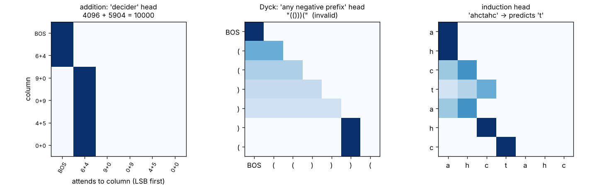

# Hand-written transformers






[Source](https://github.com/BirgerMoell/handnet/blob/main/handnet/transformer.py). A decoder-only transformer in numpy (token + position
embeddings, causal multi-head attention, ReLU MLP, residual stream, unembedding; no
LayerNorm, because every residual dimension has a meaning the author assigned), and
three sets of weights written by hand for tasks whose answer is exactly checkable.

| task | layers × heads | params | non-zero | exact accuracy |
|---|---|---|---|---|
| addition with carry (up to 12 digits) | 1 × 1 | 2,851 | 405 | 100 % |
| Dyck-1 bracket validity (≤ 48 brackets) | 2 × 1 | 654 | 26 | 100 % |
| induction / copy (26 letters, ≤ 20-long patterns) | 2 × 1 | 25,336 | 278 | 100 % |



## Why these three

Mechanistic interpretability reverse-engineers circuits like these out of trained
models: the induction head is the canonical example. Here they are built forward, with
every weight justified, and they are exact. The point for the paper is that "designed
weights" is not a euphemism for a lookup table: attention, softmax sharpness, residual
routing and ReLU arithmetic are all doing work.

## How each one is written

**Addition.** Input is the two numbers as digit *pairs*, least significant first, after a
BOS token, with one extra `0+0` column for the final carry. Output at column *i* is digit
*i* of the sum.

- Embedding: a pair (a, b) becomes `s = a+b`, `nine = [s == 9]`, `ge10 = [s >= 10]`, and
  a constant 1; the position embedding is the integer position.
- Head "decider": the carry into column *i* is decided by the nearest earlier column
  whose sum is not 9 (nines just pass a carry along). Score(i, k) = 200·(1 − nine_k) +
  5·pos_k under a strict causal mask: "not nine" dominates, recency breaks ties, and the
  gaps of ≥ 5 make the softmax ~one-hot (0.993 on `999999 + 1`). The value is that
  column's `ge10`, written into the `carry` dimension. BOS is a decider with carry 0.
- MLP: 21 units `relu(s + carry − j)`, j = −1…19. Their differences form triangular
  bumps that are 1 at exactly one integer, and bump *k* adds 1 to output digit *k* mod 10.
  That is `(a + b + carry) mod 10` in ReLUs.

**Dyck-1.** Tokens `(` = +1 and `)` = −1 in one dimension.

- Layer 1 head "depth": all scores 0, so attention is uniform over positions 0…i and the
  output is depth_i / (i+1). Its MLP computes `neg = min(relu(−C·depth), 1)` and
  `nonzero = min(relu(C·depth) + relu(−C·depth), 1)` with C = N+1, so any non-zero depth
  is at least 1 after scaling.
- Layer 2 head "any negative prefix": score = 30·neg_k. If any earlier prefix was
  negative the softmax concentrates there and reads 1; otherwise it reads 0.
- Output: invalid ⇔ anyneg + nonzero(final depth) > 0.

**Induction.** One-hot token block, a `prev` block and a `pred` block in the residual.

- Layer 1 head "previous token": score = 8·pos_k with a strict causal mask, so the most
  recent position (i−1) wins; copies its token one-hot into `prev`.
- Layer 2 head "induction": query = my token, key = your `prev`, score 20 on a match, plus
  0.5·pos_k so the most recent match wins when a letter repeats. The value is that
  position's token: what followed last time. Written into `pred`, read by the unembedding.

## Trained twins

`baselines.py` trains the identical architecture from random initialisation on 2^k
examples (Adam, 3,000 steps) and reports the same exact-match metric (`baselines.json`):

| labels seen | 0 (designed) | 64 | 256 | 1,024 | 4,096 | 16,384 |
|---|---|---|---|---|---|---|
| addition | **100.0** | 7.7 | 25.9 | 97.4 | 99.0 | 95.2 |
| Dyck-1 | **100.0** | 64.4 | 68.0 | 98.3 | 98.7 | 98.7 |
| induction | **100.0** | 5.6 | 37.2 | 98.6 | 99.6 | 99.7 |

The trained twins approximate the rule to 97–99.7 % from a thousand examples up and
never reach it; the written weights *are* the rule.

```bash
python -m handnet.transformer                   # the three nets and their accuracy
python -m pytest -q tests/test_transformer.py   # exactness, attention sharpness, torch twin
python examples/transformer/baselines.py        # trained twins (pip install torch)
```
